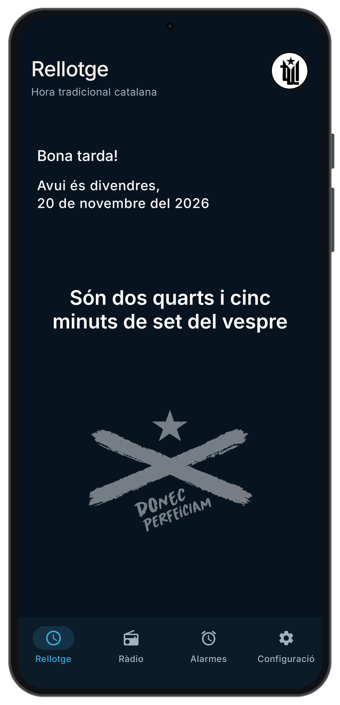
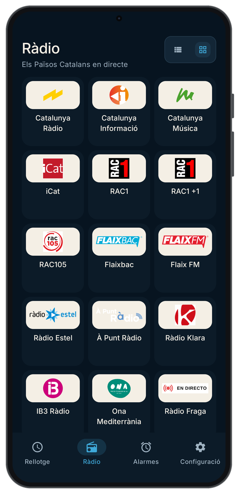
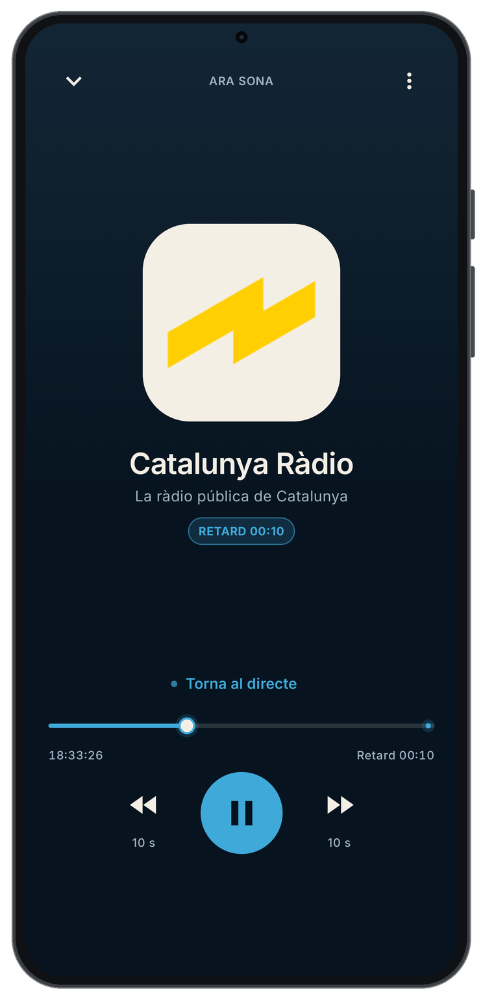
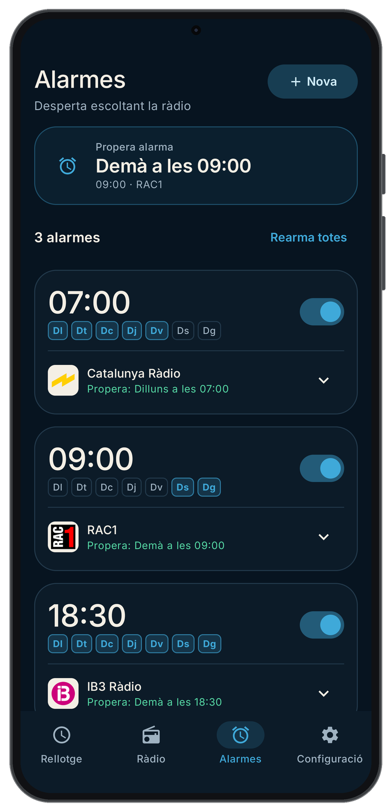

# cronos

Vaig fer cronos per tenir a mà la manera tradicional de dir l’hora en català. Si són les 6.15 del matí, hi llegiràs «És un quart de set del matí».

  
  

Android 8.0 o superior.

Pots triar entre tres ginys per veure l’hora a la pantalla d’inici, escoltar ràdio en català o posar el despertador amb l’emissora que vulguis. Si no hi ha connexió, el despertador pot fer servir un to local.

  
  
  
  

cronos no té anuncis, comptes ni analítica. Consulta la [política de privadesa](https://filldemaia.github.io/cronos/privacy.html).

## Codi font

Pots obrir el projecte amb Android Studio. A `docs/` hi ha les [notes sobre els ginys](docs/ginys.md) i les [notes de preparació de la 2.0.1](docs/publicacio-2.0.1.md). Si hi trobes cap problema, explica’l a [Incidències](https://github.com/filldemaia/cronos/issues).

Codi lliure sota la [GPL v3 o posterior](LICENSE.md). Gràcies a Gabriel Mizrahi Mejias per les primeres contribucions.

*Google Play i el logotip de Google Play són marques comercials de Google LLC.*

*[Logotip de F-Droid](https://gitlab.com/fdroid/artwork/-/tree/master/fdroid-logo-2015) de William Theaker, Robert Martinez i Andrew Nayenko, adaptat per a aquest botó sota [CC BY-SA 3.0](https://creativecommons.org/licenses/by-sa/3.0/).*
